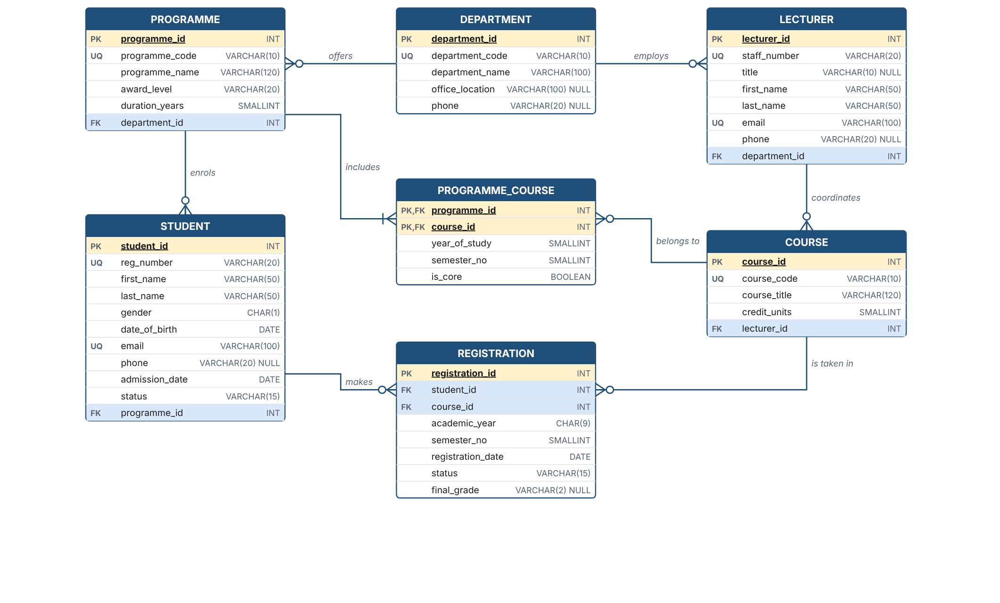

# College Registration System – Database Design

Design Activity & Practical: gather requirements for a college registration system, identify
users, processes, entities, attributes and business rules, then use **Draw.io** to produce a
conceptual model and relational tables with suitable data types.



## Deliverables
| File | What it is |
|---|---|
| [`docs/Database_Design_Specification.pdf`](docs/Database_Design_Specification.pdf) | **The one-page database design specification** (main deliverable) |
| [`docs/Presentation_Slides.pdf`](docs/Presentation_Slides.pdf) | 6-slide deck for presenting the work |
| [`diagrams/college_registration.drawio`](diagrams/college_registration.drawio) | Draw.io file. Page 1: conceptual ERD (Chen notation); page 2: relational schema (crow's foot) |
| [`diagrams/*.png`, `*.svg`](diagrams/) | Exported images of both diagrams |
| [`docs/requirements.md`](docs/requirements.md) | Full requirements: users, processes, entities, attributes, business rules, design checks |
| [`sql/01_schema.sql`](sql/01_schema.sql) | `CREATE TABLE` script: data types, PKs, FKs, UNIQUE and CHECK constraints |
| [`sql/02_sample_data.sql`](sql/02_sample_data.sql) | Sample data for a demo |
| [`sql/03_queries.sql`](sql/03_queries.sql) | Example queries (class list, registration slip, curriculum, pending approvals, rule audit) |

## Model summary
**Entities:** Department, Programme, Lecturer, Course, Student, Programme_Course (associative),
Registration (associative).

| Relationship | Type | Implemented as |
|---|---|---|
| Department offers Programme | 1 : N | `programme.department_id` FK |
| Department employs Lecturer | 1 : N | `lecturer.department_id` FK |
| Programme enrols Student | 1 : N | `student.programme_id` FK |
| Lecturer coordinates Course | 1 : N | `course.lecturer_id` FK |
| Programme includes Course | M : N | `programme_course` (composite PK) |
| Student registers for Course | M : N | `registration` + UNIQUE (student, course, year, semester) |

## How to open the diagram in Draw.io
1. Go to <https://app.diagrams.net>.
2. Choose **File → Open from → Device…** and select `diagrams/college_registration.drawio`.
3. Use the page tabs at the bottom to switch between the **Conceptual Model** and the **Relational Schema**.
4. To export an image, choose **File → Export as → PNG / PDF**.

## How to run the SQL
The scripts are portable and run on **MySQL 8.0.16+** (for example XAMPP or MySQL Workbench) and **PostgreSQL 12+**.
```sql
-- MySQL
CREATE DATABASE college_reg; USE college_reg;
SOURCE sql/01_schema.sql; SOURCE sql/02_sample_data.sql; SOURCE sql/03_queries.sql;
```
```bash
# PostgreSQL
createdb college_reg
psql -d college_reg -f sql/01_schema.sql -f sql/02_sample_data.sql -f sql/03_queries.sql
```
In MySQL, Q3 in `03_queries.sql` needs `CONCAT(l.title, ' ', l.last_name)` instead of `||` (the alternative is noted in the file).

## Rebuilding the outputs
The diagrams are generated from one model definition, so the Draw.io file, the images and the
specification always agree:
```bash
python3 tools/build_diagrams.py        # writes diagrams/*.drawio and *.svg
# then print docs/specification.html and docs/presentation.html to PDF from a browser
```
